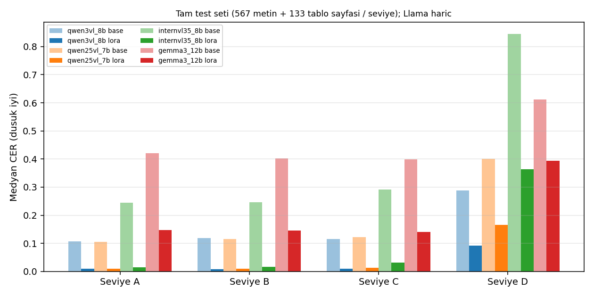
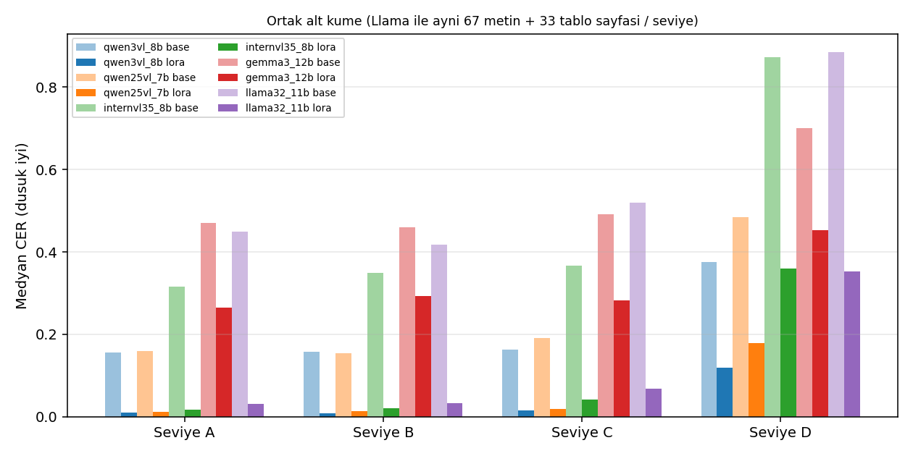
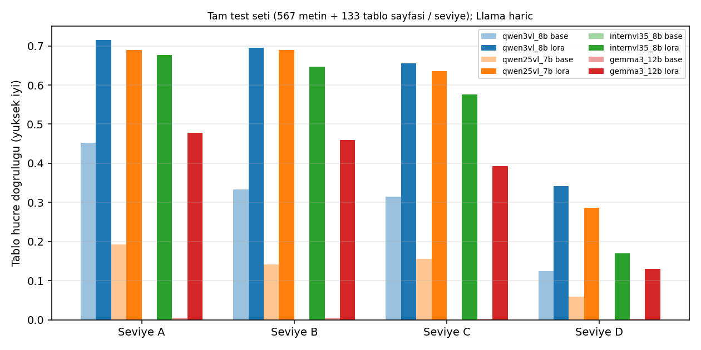
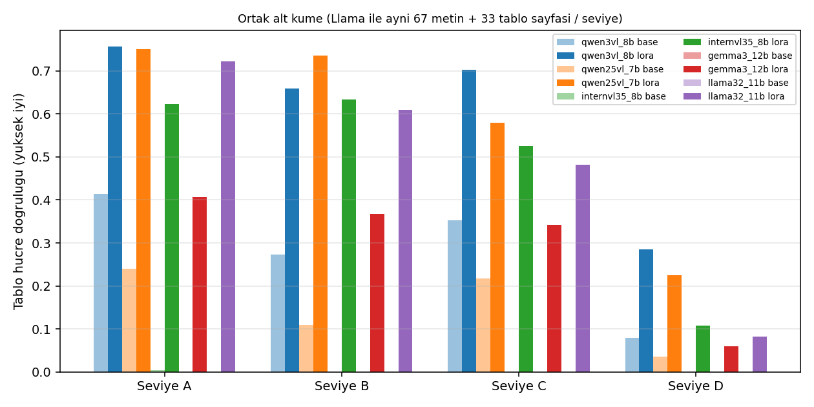

# KAP Türkçe Belge Okuma: Görüntü-Dil Modellerine LoRA

Türkçe finansal belgelerde (KAP bildirimleri) **sayfa görüntüsünden metin ve tablo okuma** işini 5 açık görüntü-dil (VL) modeliyle
karşılaştıran ve her birine küçük bir **LoRA** ince ayarı uygulayıp ne kadar kazandırdığını ölçen bir proje. Model yalnızca sayfa **görüntüsünü**
görür; cevap anahtarı PDF'in kendi metin katmanıdır (elle etiketleme yok). Taranmış/fotoğraflanmış belgeyi taklit etmek için görüntüler
dört seviyede (A temiz → D ağır) **yapay olarak bozulur**.


> **Proje durumu: tamamlandı** (v2, Ekim 2026). Kapsam: 5 model, tek eğitim koşusu, yapay bozulmalı test.
>
> **Kısaca:** Qwen3-VL-8B + LoRA, temiz sayfalarda medyan karakter hata oranını (CER) **0,107 → 0,009**'a (≈ 12 kat), ağır bozulmada **0,289 → 0,092**'ye (≈ 3 kat)
> indiriyor; finansal tablo çıkarımında hücre doğruluğunu **0,45 → 0,72**'ye çıkarıyor. Etki 5 modelin hepsinde var ama büyüklüğü modele göre çok değişiyor.
> **Dikkat:** tek eğitim koşusu, yapay bozulma, gerçek tarama testi yok. Sınırlamalar aşağıda.

---

## İçindekiler
1. [Sonuç özeti](#1-sonuç-özeti)
2. [Ayrıntılı sonuçlar](#2-ayrıntılı-sonuçlar)
3. [Gerçek çıktı örnekleri](#3-gerçek-çıktı-örnekleri)
4. [Ne yaptık, nasıl yaptık](#4-ne-yaptık-nasıl-yaptık)
5. [Hugging Face adaptörleri](#5-hugging-face-adaptörleri)
6. [Depo yapısı ve yeniden üretme](#6-depo-yapısı-ve-yeniden-üretme)
7. [Sınırlamalar](#7-sınırlamalar)
8. [Lisans ve veri notları](#8-lisans-ve-veri-notları)

---

## 1. Sonuç özeti

Aynı test sayfaları, aynı istem ve ayarlar; tek fark LoRA adaptörü. Her hücre **taban model → LoRA**.
**CER** = karakter hata oranı (düşük iyi, medyan). **Hücre doğruluğu** = tablodaki sayısal hücrelerin birebir doğru oranı (yüksek iyi).
Test: 80 şirket, **567 transkripsiyon + 133 tablo sayfası, her seviyede aynı sayfalar**. Tüm sayılar tek koşu.

| Model | CER, temiz (A) | CER, ağır bozulma (D) | Tablo hücre doğr., temiz (A) | Tablo hücre doğr., ağır (D) |
|---|---|---|---|---|
| **Qwen3-VL-8B** | 0,107 → **0,009** | 0,289 → **0,092** | 0,45 → **0,72** | 0,12 → **0,34** |
| **Qwen2.5-VL-7B** | 0,105 → **0,009** | 0,401 → **0,165** | 0,19 → **0,69** | 0,06 → **0,29** |
| **InternVL3.5-8B** | 0,245 → **0,015** | 0,845 → **0,364** | 0,00 → **0,68** | 0,00 → **0,17** |
| **Gemma 3 12B** | 0,421 → **0,147** | 0,612 → **0,394** | 0,01 → **0,48** | 0,00 → **0,13** |
| **Llama 3.2 11B Vision**\* | 0,449 → **0,032** | 0,885 → **0,352** | 0,00 → **0,72** | 0,00 → **0,08** |

\* Llama 3.2 yalnızca her seviyenin **ilk 100 örneğinde** (≈ 67 transkripsiyon + 33 tablo) ve Hugging Face `generate` ile ölçüldü (vLLM bu modeli desteklemiyor).
Diğer modellerle adil kıyas için [`results/FINAL_RESULTS.md`](results/FINAL_RESULTS.md) içindeki **ortak alt küme** tablosuna bakın.

**Sonuçtan çıkanlar**
1. **LoRA her modelde işe yarıyor, ama büyüklüğü farklı.** Qwen ve InternVL'de temiz/hafif/orta bozulmada hata ≈ **9–17 kat**, Llama 3.2'de ≈ **8–14 kat** düşüyor. Gemma 3'te yalnızca ≈ 3 kat.
2. **Ağır bozulma (D) hâlâ zor.** Kazanç 1,6–3 kata düşüyor ve en iyi modelde bile medyan CER 0,09. Küçük, bulanık, JPEG'li taramalar çözülmüş sayılmaz.
3. **Sıralama (LoRA sonrası, temiz sayfada): Qwen3-VL ≈ Qwen2.5-VL > InternVL3.5 > Llama 3.2 ≫ Gemma 3** (ortak alt küme CER: 0,011 / 0,012 / 0,018 / 0,032 / 0,266).
   Qwen3 ile Qwen2.5 temiz/hafif/orta seviyelerde ayrışmıyor (güven aralıkları örtüşüyor); ağır bozulmada Qwen3 önde (tam test seti D: 0,092 [0,072–0,111] vs 0,165 [0,131–0,193]).
   Llama (n=67) güven aralıkları geniş: onu InternVL3.5'in biraz gerisinde, Gemma'nın çok önünde saymak güvenli; daha ince sıralama iddia edilmez.
4. **Taban modelin hatasının bir kısmı biçim hatası.** İnce ayarsız modeller düz metin yerine markdown tablosu yazabiliyor; InternVL3.5, Gemma 3 ve Llama 3.2 taban halleriyle JSON tablo şemasını
   neredeyse hiç üretemiyor (geçerli JSON %0–5). Bu yüzden onlardaki tablo kazancı büyük ölçüde "formatı öğrenme"dir; Qwen3-VL taban halinde JSON'a uyuyor (%95), onun kazancı (0,45 → 0,72) daha çok gerçek okuma.
5. **Tablo satır yapısı zayıf.** Hücre değerleri iyi okunsa da çıktıdaki satır sayısının referansla birebir tutması en iyi modelde ≈ %35 (katı ölçüt; etiket gürültüsü de payı olabilir).

---

## 2. Ayrıntılı sonuçlar

Tüm tablolar **%95 bootstrap güven aralıklarıyla** [`results/FINAL_RESULTS.md`](results/FINAL_RESULTS.md) içinde (ham veri: [`results/final/final_summary.csv`](results/final/final_summary.csv)).
Aşağıda öne çıkanlar. Köşeli parantez: %95 güven aralığı (sayfa düzeyinde bootstrap).

### 2.1 Transkripsiyon: medyan CER (düşük iyi)

| Model | Seviye | Taban | + LoRA | Kat |
|---|---|---|---|---|
| Qwen3-VL-8B | A temiz | 0,107 [0,091–0,124] | **0,009** [0,007–0,011] | 11,9× |
| | B hafif | 0,119 [0,094–0,131] | **0,007** [0,006–0,009] | 17× |
| | C orta | 0,116 [0,102–0,128] | **0,010** [0,007–0,012] | 11,6× |
| | D ağır | 0,289 [0,249–0,352] | **0,092** [0,072–0,111] | 3,1× |
| Qwen2.5-VL-7B | A | 0,105 [0,097–0,115] | **0,009** [0,007–0,011] | 11,7× |
| | B | 0,115 [0,103–0,128] | **0,010** [0,008–0,012] | 11,5× |
| | C | 0,121 [0,112–0,138] | **0,013** [0,011–0,017] | 9,3× |
| | D | 0,401 [0,348–0,450] | **0,165** [0,131–0,193] | 2,4× |
| InternVL3.5-8B | A | 0,245 [0,226–0,262] | **0,015** [0,012–0,017] | 16,3× |
| | B | 0,246 [0,227–0,265] | **0,016** [0,012–0,021] | 15,4× |
| | C | 0,292 [0,262–0,341] | **0,031** [0,027–0,039] | 9,4× |
| | D | 0,845 [0,826–0,868] | **0,364** [0,308–0,414] | 2,3× |
| Gemma 3 12B | A | 0,421 [0,403–0,440] | **0,147** [0,098–0,178] | 2,9× |
| | B | 0,402 [0,383–0,425] | **0,145** [0,111–0,177] | 2,8× |
| | C | 0,398 [0,384–0,420] | **0,141** [0,116–0,185] | 2,8× |
| | D | 0,612 [0,586–0,651] | **0,394** [0,359–0,426] | 1,6× |
| Llama 3.2 11B Vision\* | A | 0,449 [0,379–0,557] | **0,032** [0,018–0,052] | 14,0× |
| | B | 0,417 [0,365–0,602] | **0,033** [0,018–0,052] | 12,6× |
| | C | 0,520 [0,452–0,743] | **0,068** [0,030–0,104] | 7,6× |
| | D | 0,885 [0,848–0,917] | **0,352** [0,244–0,456] | 2,5× |



#### Ortak alt küme: 5 modelin adil karşılaştırması

Llama 3.2 yalnızca her seviyenin ilk 100 örneğinde ölçüldü. Beş modeli **aynı sayfalarda** karşılaştırmak için diğer modelleri de bu alt kümede yeniden hesapladık
(**yalnızca 67 transkripsiyon + 33 tablo sayfası/seviye**: aralıklar geniştir, küçük farkları yorumlamayın; tam aralıklar `results/FINAL_RESULTS.md`'de). Bu alt küme tam test setinden biraz zor çıktı (tüm medyanlar daha yüksek).

Medyan CER, taban → LoRA:

| Model | A | B | C | D |
|---|---|---|---|---|
| Qwen3-VL-8B | 0,156 → **0,011** | 0,158 → **0,009** | 0,164 → **0,015** | 0,375 → **0,118** |
| Qwen2.5-VL-7B | 0,159 → **0,012** | 0,155 → **0,014** | 0,192 → **0,019** | 0,484 → **0,179** |
| InternVL3.5-8B | 0,316 → **0,018** | 0,349 → **0,021** | 0,366 → **0,042** | 0,873 → **0,359** |
| Llama 3.2 11B Vision | 0,449 → **0,032** | 0,417 → **0,033** | 0,520 → **0,068** | 0,885 → **0,352** |
| Gemma 3 12B | 0,470 → **0,266** | 0,460 → **0,292** | 0,491 → **0,283** | 0,700 → **0,453** |



### 2.2 Sayı doğruluğu (sayı F1, yüksek iyi)

Tutarlar ve tarihler finansal belgede kritik. Sayı F1, referanstaki ve çıktıdaki sayı dizilerinin eşleşmesini ölçer.

| Model | A: taban → LoRA | D: taban → LoRA |
|---|---|---|
| Qwen3-VL-8B | 0,920 → **0,961** | 0,564 → **0,678** |
| Qwen2.5-VL-7B | 0,908 → **0,948** | 0,532 → **0,640** |
| InternVL3.5-8B | 0,875 → **0,949** | 0,304 → **0,518** |
| Gemma 3 12B | 0,741 → **0,778** | 0,405 → **0,518** |

Sayılarda kazanç, harflerdekinden küçük (taban modeller sayıları zaten nispeten iyi okuyor), ama temiz sayfada bile LoRA'lı en iyi modelin sayı F1'i 0,96 civarı: yani sayıların yaklaşık **%4'ü hâlâ yanlış/eksik** — mali veri için kritik bir sınır.

### 2.3 Tablo çıkarımı (JSON)

Görev: tablo sayfası → `{"kalem", "dipnot", "degerler"}` satırları. **Hücre doğruluğu**, **geçerli JSON** oranı (çıktı şemaya uyuyor mu).

| Model | Hücre doğruluğu A | C | D | Geçerli JSON A (taban → LoRA) |
|---|---|---|---|---|
| Qwen3-VL-8B | 0,45 → **0,72** | 0,31 → **0,66** | 0,12 → **0,34** | 0,95 → 0,96 |
| Qwen2.5-VL-7B | 0,19 → **0,69** | 0,16 → **0,64** | 0,06 → **0,29** | 0,56 → 0,92 |
| InternVL3.5-8B | 0,00 → **0,68** | 0,00 → **0,58** | 0,00 → **0,17** | 0,03 → 0,97 |
| Gemma 3 12B | 0,01 → **0,48** | 0,00 → **0,39** | 0,00 → **0,13** | 0,02 → 0,96 |
| Llama 3.2 11B Vision\*\* | 0,00 → **0,72** | 0,00 → **0,48** | 0,00 → **0,08** | 0,00 → 0,97 |

\*\* Llama için yalnızca 33 tablo sayfası/seviye (ortak alt küme).

Ortak alt kümede (33 tablo sayfası/seviye) hücre doğruluğu, taban → LoRA:

| Model | A | B | C | D |
|---|---|---|---|---|
| Qwen3-VL-8B | 0,41 → **0,76** | 0,27 → **0,66** | 0,35 → **0,70** | 0,08 → **0,29** |
| Qwen2.5-VL-7B | 0,24 → **0,75** | 0,11 → **0,74** | 0,22 → **0,58** | 0,04 → **0,22** |
| Llama 3.2 11B Vision | 0,00 → **0,72** | 0,00 → **0,61** | 0,00 → **0,48** | 0,00 → **0,08** |
| InternVL3.5-8B | 0,00 → **0,62** | 0,00 → **0,63** | 0,00 → **0,52** | 0,00 → **0,11** |
| Gemma 3 12B | 0,00 → **0,41** | 0,00 → **0,37** | 0,00 → **0,34** | 0,00 → **0,06** |




### 2.4 Eğitim bilgileri

| Model | Eğitim süresi (A100 80 GB) | Son doğrulama kaybı |
|---|---|---|
| Qwen3-VL-8B | 90 dk | 0,0163 |
| Qwen2.5-VL-7B | 152 dk | 0,0201 |
| InternVL3.5-8B | 151 dk | 0,0509 |
| Gemma 3 12B | 128 dk | 0,3494 |
| Llama 3.2 11B Vision | 134 dk | 0,0581 |

(Kayıplar tokenizer farkı yüzünden modeller arasında karşılaştırılamaz. Gemma'nın yüksek kaybı zayıf CER sonucuyla tutarlı; nedeni doğrulanmadı —
Gemma 3 görüntüyü sabit 896×896'ya getirdiği için yoğun sayfalarda ayrıntı kaybı bir aday açıklamadır.)

### 2.5 Önceki (v1) koşuyla fark
İlk deneme (Qwen2.5/Qwen3, 1000 örnek) bu veri hattının hatalarını gösterdi ve v2'yi biçimlendirdi: referansta yalnızca SPK doğrulama damgası olan sayfalar CER'i şişiriyordu
(filtrelendi), test seti küçüktü (tablo n=72 → 133). v1 sonuçları [`results/RESULTS.md`](results/RESULTS.md) içinde duruyor; v2 sayıları onunla birebir kıyaslanamaz.

---

## 3. Gerçek çıktı örnekleri

Aşağıdakiler testten **otomatik** seçildi (kural: [`results/EXAMPLES.md`](results/EXAMPLES.md) içinde; elle ayıklanmadı). Tam örnekler (4 metin + 1 tablo, başarısızlık örneği dahil) orada.

**Örnek: orta bozulmalı (C) bir izahname sayfası, Qwen3-VL-8B**

| | Çıktı (alıntı) | CER |
|---|---|---|
| Referans | `İzahname` · `İlgili Şirketler [NETCD]` · `… İzahnamesinin 1. bölümü ekte yer almakta olup` · `Saygılarımızla.` | |
| **Taban** | `KAP` `KARAYI ATIKLAMA PLATFORMU` `PUBLIC DISCLOSURE PLATFORM` · `Izahname` · `İlgili Şirketler (NETCD)` · `… Izahnamesinin …` · `Saygılarımla,` | 0,150 |
| **LoRA** | `İzahname` · `İlgili Şirketler [NETCD]` · `… İzahnamesinin 1. bölümü ekte yer almakta olup` · `Saygılarımızla.` | **0,000** |

Taban model sayfada olmayan bir üst başlık uydurup (`KARAYI ATIKLAMA PLATFORMU` — gerçek: *Kamuyu Aydınlatma Platformu* logosunu yanlış okumuş) `İ` harfini `I`'ya çevirmiş ve kelimeleri bozmuş; LoRA hepsini referansla birebir okumuş.

**Örnek: temiz sayfada biçim farkı.** Aynı modelde yönetim kurulu listesi sayfasında taban CER'i 0,326: modelin metni düz yazı yerine **markdown tablosu** olarak üretmesi (`| Adı Soyadı | Görevi | …`) ve bir kelimeyi bozması
(`Yönetim Organi` yerine `Organı`) bu CER'in büyük kısmını oluşturuyor. LoRA düz metin biçimini öğrenip 0,007'ye iniyor. Yani taban CER'indeki fark kısmen **biçim uyumudur**, tamamen "daha iyi görme" değildir (bkz. [Sınırlamalar](#7-sınırlamalar)).

---

## 4. Ne yaptık, nasıl yaptık

Ayrıntılı anlatım: [`docs/METHODOLOGY.md`](docs/METHODOLOGY.md).

```
KAP bildirimleri (Oca–Eyl 2026)   500 bildirim, 391 şirket, 3169 sayfa
        │  kap_collect.py → make_pages.py (130 DPI) → table_extract.py
        ▼
Sayfa görüntüsü + referans (PDF metin katmanı; tablo satırları heuristikle)
        │  degrade.py: A temiz / B hafif / C orta / D ağır (yapay tarama bozulması)
        ▼
make_dataset.py: şirket bazlı bölme 261 / 50 / 80   (sızıntı yok)
   eğitim 2500 (2000 metin + 500 tablo) · doğrulama 500 · test 700 × 4 seviye (aynı sayfalar)
        │  train_lora.py (Unsloth, LoRA r=32, 2 epoch)  ×5 model
        ▼
eval_vllm.py → metrics.py → final_report.py (bootstrap %95 GA) → make_examples.py
```

- **Veri:** KAP bildirim PDF'leri. Etiket yok, referans = PDF metin katmanı. Damga-only sayfalar (referans < 150 karakter) çıkarıldı.
- **Bozulma:** gri ton, düşük çözünürlük, döndürme, bulanıklık, gürültü, gölge, JPEG (olasılıkla uygulanan adımlar; parametreler `degrade.py` ve METHODOLOGY).
- **Eğitim:** 16-bit LoRA (r=32, α=64), yalnızca dil katmanları, görüntü kodlayıcı dondurulmuş; 2500 örnek × 2 epoch; hepsi için aynı ayarlar.
- **Ölçüm:** CER/WER, Türkçe karakter doğruluğu, sayı F1; tablo için geçerli JSON, hücre doğruluğu, satır sayısı eşleşmesi. Güven aralıkları bootstrap ile.
- **Kodun kendisi** `prompts/` altındaki belirtimlerden LLM yardımıyla üretildi ve elle doğrulandı (bkz. `prompts/`).

---

## 5. Hugging Face adaptörleri

LoRA adaptörleri (taban ağırlıklar ayrıca indirilir; her adaptör ≈ 0,3–0,5 GB):

| Model | Adaptör | Taban model |
|---|---|---|
| Qwen3-VL-8B | [`furkancmc/Qwen3-VL-8B-KAP-TR-LoRA`](https://huggingface.co/furkancmc/Qwen3-VL-8B-KAP-TR-LoRA) | `Qwen/Qwen3-VL-8B-Instruct` |
| Qwen2.5-VL-7B | [`furkancmc/Qwen2.5-VL-7B-KAP-TR-LoRA`](https://huggingface.co/furkancmc/Qwen2.5-VL-7B-KAP-TR-LoRA) | `Qwen/Qwen2.5-VL-7B-Instruct` |
| InternVL3.5-8B | [`furkancmc/InternVL3.5-8B-KAP-TR-LoRA`](https://huggingface.co/furkancmc/InternVL3.5-8B-KAP-TR-LoRA) | `OpenGVLab/InternVL3_5-8B-HF` |
| Gemma 3 12B | [`furkancmc/Gemma-3-12B-KAP-TR-LoRA`](https://huggingface.co/furkancmc/Gemma-3-12B-KAP-TR-LoRA) | `google/gemma-3-12b-it` |
| Llama 3.2 11B Vision | [`furkancmc/Llama-3.2-11B-Vision-KAP-TR-LoRA`](https://huggingface.co/furkancmc/Llama-3.2-11B-Vision-KAP-TR-LoRA) | `meta-llama/Llama-3.2-11B-Vision-Instruct` |

Her depoda model kartı (sonuçlar, eğitim ayarları, kullanım kodu, lisans notu) var. Hızlı kullanım:

```python
import torch
from PIL import Image
from peft import PeftModel
from transformers import AutoModelForImageTextToText, AutoProcessor

BASE, ADAPTER = "Qwen/Qwen3-VL-8B-Instruct", "furkancmc/Qwen3-VL-8B-KAP-TR-LoRA"
model = AutoModelForImageTextToText.from_pretrained(BASE, torch_dtype=torch.bfloat16, device_map="auto")
model = PeftModel.from_pretrained(model, ADAPTER).eval()
processor = AutoProcessor.from_pretrained(BASE)

prompt = "Bu sayfadaki tüm metni okuma sırasına uygun şekilde, olduğu gibi yaz."
image = Image.open("sayfa.png").convert("RGB")
messages = [{"role": "user", "content": [{"type": "image"}, {"type": "text", "text": prompt}]}]
text = processor.apply_chat_template(messages, add_generation_prompt=True)
inputs = processor(text=text, images=[image], return_tensors="pt").to(model.device)
out = model.generate(**inputs, max_new_tokens=2048, do_sample=False)
print(processor.batch_decode(out[:, inputs["input_ids"].shape[1]:], skip_special_tokens=True)[0])
```

---

## 6. Depo yapısı ve yeniden üretme

| Dosya | Görevi |
|---|---|
| `kap_collect.py`, `inventory.py` | KAP bildirimlerini seç/indir, envanter |
| `make_pages.py`, `table_extract.py` | PDF → sayfa görüntüsü, metin ve tablo etiketi |
| `degrade.py` | A–D bozulma seviyeleri |
| `make_dataset.py` | Şirket bazlı bölme, filtre, `dataset.zip` |
| `model_zoo.py`, `train_lora.py`, `merge_lora.py` | 5 modelin kaydı, LoRA eğitimi, birleştirme |
| `eval_vllm.py`, `metrics.py` | Değerlendirme (vLLM / HF) ve metrikler |
| `report.py`, `final_report.py`, `make_examples.py`, `make_model_cards.py` | Raporlar, güven aralıkları, örnekler, model kartları |
| `colab/setup_all.sh`, `colab/run_all.sh` | Colab A100'de 5 modeli sıralı eğiten/değerlendiren zincir |
| `ocr_eval.py`, `ocr_eval_vllm.py` | OCR modelleri için deneme kodu (karşılaştırma kapsam dışı, bkz. Sınırlamalar) |
| `results/` | `FINAL_RESULTS.md`, `EXAMPLES.md`, `final/` (CSV + grafikler), v1: `RESULTS.md` |
| `docs/METHODOLOGY.md` | Ayrıntılı yöntem |

```bash
python kap_collect.py && python inventory.py && python make_pages.py && python make_dataset.py --zip
# Colab A100: bash colab/setup_all.sh && bash colab/run_all.sh   (5 model, ≈ 10–12 saat)
python final_report.py --eval-root <drive>/v2/eval --out results/final
```

Ham KAP verisi ve PDF'ler depoda **yoktur**; `kap_collect.py` ile yeniden indirilir.

---

## 7. Sınırlamalar

1. **Yapay bozulma, gerçek tarama yok.** "Taranmış belge" sonuçları yapay bozulmadan gelir; gerçek tarama/fotoğraf genellemesi **ölçülmedi**. En önemli açık nokta.
2. **Etiket gürültüsü.** Referans PDF metin katmanı; okuma sırası ve **tablo satırları heuristikle** çıkarıldı. Tablo "satır sayısı eşleşmesi" düşüklüğünün bir kısmı model değil etiket kaynaklı olabilir. Etiketlerin küçük bir kısmı elle doğrulanmadı.
3. **Tek koşu, tek tohum.** Güven aralıkları test örneklemesini gösterir, **eğitim rastgeleliğini göstermez.** Birbirine yakın sonuçlar (Qwen3 ↔ Qwen2.5, A–C) arasında sıralama iddia edilmez.
4. **Şablon metin.** KAP sayfalarında tekrarlayan şablon çoktur; yüksek doğruluğun bir kısmı bu şablonları öğrenmekten gelebilir. Şablonsuz serbest metinde sonuçlar daha kötü olabilir.
5. **Taban model hatasının bir kısmı biçim hatası** (markdown/JSON şeması). Kazançlar tamamen "daha iyi okuma" değildir; özellikle InternVL3.5, Gemma 3, Llama 3.2 tablo sonuçlarında.
6. **Llama 3.2 farklı protokol:** yalnızca ilk 100 örnek/seviye, HF motoruyla, en çok 2048 token. Ortak alt küme tablosuyla kıyaslayın.
7. **Kısa eğitim:** 2 epoch, 2500 örnek. Daha uzun/geniş eğitim sonuçları değiştirebilir. Kaçak (tekrar döngüsü) üretim ağır bozulmada hâlâ görülüyor; `repetition_penalty` denenmedi.
8. **Hazır OCR modelleriyle kıyas yok.** PaddleOCR-VL, HunyuanOCR ve DeepSeek-OCR ile zero-shot karşılaştırma bu çalışmanın kapsamında değildir; deneme kodu (`ocr_eval_vllm.py`) depoda durur. PaddleOCR-VL için yalnızca kısmi bir ön ölçüm alındı, rapora dahil edilmedi.
9. **Yalnızca KAP.** Başka belge türleri/ülkeleri test edilmedi.

## 8. Lisans ve veri notları

- Bu depodaki **kod**: MIT (bkz. `LICENSE`).
- **Adaptörler** taban modellerin lisanslarına tabidir: Qwen3-VL / Qwen2.5-VL / InternVL3.5 (Apache-2.0 olarak bildirilmiştir; kullanmadan önce taban model sayfasını doğrulayın),
  **Gemma** (Gemma Kullanım Şartları), **Llama 3.2** ("Built with Llama"; Llama 3.2 Community License — görüntü destekli modeller AB'de yerleşik kişi/şirketlerce kullanılamaz).
- **Veri:** KAP kamuya açık bildirimlerdir; ancak **yeniden dağıtım koşulları ayrıca doğrulanmalıdır**. Bu yüzden ham veri ve PDF'ler depoda paylaşılmaz; `examples/` altında yalnızca tek bir sayfa görüntüsü ve çıktısı örnek olarak, `results/EXAMPLES.md` içinde kısa alıntılar bulunur.
- Bu bir araştırma/öğrenme projesidir; finansal karar veya otomatik işleme için kullanılmamalıdır.
