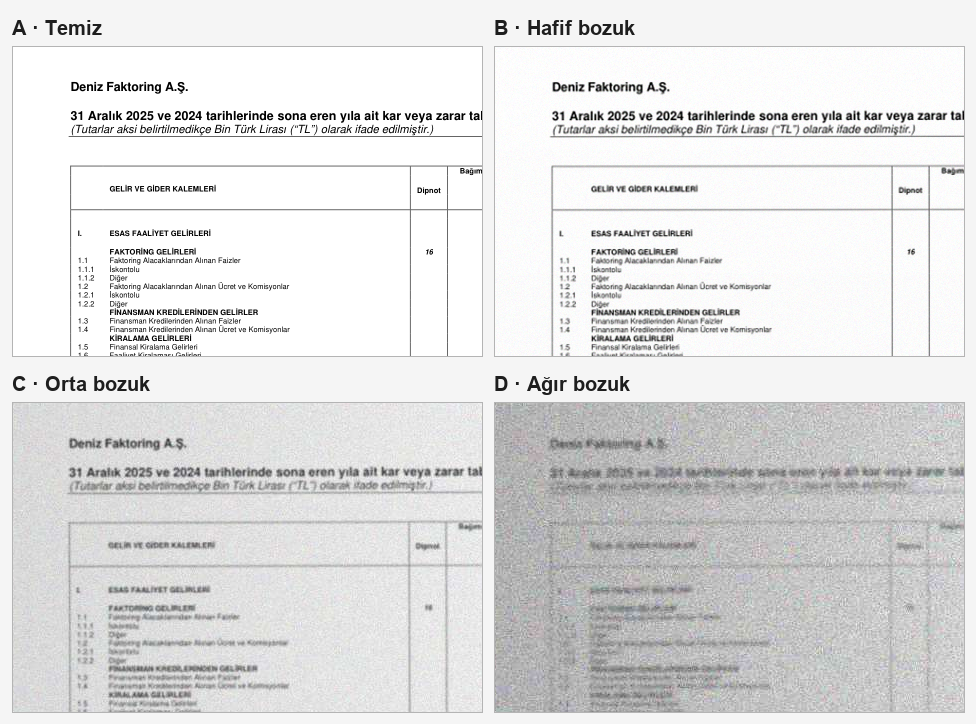

# KAP Türkçe Belge Okuma: Görüntü-Dil Modellerine LoRA

**Türkçe finansal belgelerin (KAP bildirimleri) fotoğrafını/taramasını okuyan yapay zekâ modellerini karşılaştıran ve küçük bir ek eğitimle (LoRA) ne kadar düzeldiklerini ölçen bir proje.**


## Proje ne yapıyor?

Şirketler KAP'a (Kamuyu Aydınlatma Platformu) PDF olarak bildirim yükler. Bu PDF'lerin bir sayfasının **resmini** bir yapay zekâ modeline verip
"bu sayfada ne yazıyor?" ve "bu tablodaki rakamlar neler?" diye soruyoruz. Sonra modelin cevabını doğru cevapla karşılaştırıp ne kadar hata yaptığını ölçüyoruz.

- **5 model** denedik: Qwen3-VL, Qwen2.5-VL, InternVL3.5, Gemma 3 ve Llama 3.2 Vision.
- Her modeli iki halde ölçtük: **ilk hali** (hiç ek eğitim yok) ve **LoRA'lı hali** (KAP sayfalarıyla küçük bir ek eğitim almış hali).
- Doğru cevabı elle yazmadık: PDF'in içindeki gerçek metni kullandık. Model bu metni görmez, yalnızca sayfanın resmini görür.
- Gerçek taramalar elimizde olmadığı için sayfaları **bilgisayarla bozduk** (4 seviye, aşağıda görsel var).

> **Kısaca:** En iyi model olan Qwen3-VL, temiz sayfalarda yaptığı hatayı yaklaşık **12 kat**, çok bozuk sayfalarda yaklaşık **3 kat** azalttı.
> Finansal tablolardaki hücrelerin doğru okunma oranı **%45'ten %72'ye** çıktı. Etki 5 modelde de var ama büyüklüğü modele göre çok değişiyor.
>
> **Dikkat:** Her model yalnızca bir kez eğitildi ve testte gerçek tarama yok, yapay bozulma var. Ayrıntı için [Sınırlamalar](#7-sınırlamalar).

## Kısa sözlük

| Terim | Anlamı |
|---|---|
| **Görüntü-dil modeli (VL)** | Hem resmi hem yazıyı anlayan yapay zekâ modeli. |
| **LoRA** | Büyük modeli baştan eğitmek yerine, ona küçük bir "ek parça" eğitme yöntemi. Hızlı ve ucuz; ek parça yaklaşık 0,3–0,5 GB. |
| **Taban model** | Hiç ek eğitim almamış, orijinal model. |
| **CER (karakter hata oranı)** | Modelin yazdığı metinde kaç karakterin yanlış olduğu. **0 = kusursuz**, düşük iyi. Örneğin 0,01 = yüz karakterde yaklaşık bir hata. Tüm sayfaların ortadaki (medyan) değeri alınır. |
| **Hücre doğruluğu** | Tablodaki sayıların kaçının birebir doğru okunduğu. Yüksek iyi. |
| **Geçerli JSON** | Modelin tabloyu istenen düzenli biçimde yazıp yazamadığı. |
| **Güven aralığı** | Sonucun ne kadar oynayabileceğini gösteren aralık, `[alt–üst]` biçiminde. Aralıklar üst üste biniyorsa iki sonucu birbirinden üstün saymayız. |

## Bozulma seviyeleri: A, B, C, D

Gerçek tarama veya telefon fotoğrafını taklit etmek için aynı sayfa dört seviyede hazırlandı (gerçek bir KAP gelir tablosundan bir kesit):



| Seviye | Nasıl bir görüntü? |
|---|---|
| **A** | Temiz dijital sayfa, hiç bozulma yok. |
| **B** | Hafif: çok az bulanıklık ve gürültü. |
| **C** | Orta: gri tonlama, bulanıklık, hafif eğiklik, gölge, JPEG sıkıştırma. |
| **D** | Ağır: çözünürlük yarıya iner, yoğun gürültü, çok bulanık; zor okunur. |

---

## İçindekiler
1. [Sonuç özeti](#1-sonuç-özeti)
2. [Ayrıntılı sonuçlar](#2-ayrıntılı-sonuçlar)
3. [Örnek çıktılar](#3-örnek-çıktılar)
4. [Nasıl yaptık?](#4-nasıl-yaptık)
5. [Hugging Face adaptörleri](#5-hugging-face-adaptörleri)
6. [Depo yapısı ve yeniden üretme](#6-depo-yapısı-ve-yeniden-üretme)
7. [Sınırlamalar](#7-sınırlamalar)
8. [Lisans ve veri notları](#8-lisans-ve-veri-notları)

---

## 1. Sonuç özeti

Aynı test sayfaları, aynı soru ve aynı ayarlar; tek fark LoRA. Her hücrede **taban model → LoRA'lı model** yazıyor.
Test: 80 şirket, **567 metin + 133 tablo sayfası**; her seviyede aynı sayfalar kullanıldı. Tüm sayılar tek eğitim koşusundan.

| Model | Metin hatası (CER), temiz (A) | Metin hatası (CER), ağır bozuk (D) | Tablo hücre doğruluğu, temiz (A) | Tablo hücre doğruluğu, ağır bozuk (D) |
|---|---|---|---|---|
| **Qwen3-VL-8B** | 0,107 → **0,009** | 0,289 → **0,092** | 0,45 → **0,72** | 0,12 → **0,34** |
| **Qwen2.5-VL-7B** | 0,105 → **0,009** | 0,401 → **0,165** | 0,19 → **0,69** | 0,06 → **0,29** |
| **InternVL3.5-8B** | 0,245 → **0,015** | 0,845 → **0,364** | 0,00 → **0,68** | 0,00 → **0,17** |
| **Gemma 3 12B** | 0,421 → **0,147** | 0,612 → **0,394** | 0,01 → **0,48** | 0,00 → **0,13** |
| **Llama 3.2 11B Vision**\* | 0,449 → **0,032** | 0,885 → **0,352** | 0,00 → **0,72** | 0,00 → **0,08** |

\* Llama 3.2 yalnızca her seviyenin **ilk 100 örneğinde** (≈ 67 metin + 33 tablo sayfası) ve farklı bir yöntemle ölçüldü (vLLM bu modeli desteklemiyor).
Adil kıyas için [aşağıdaki ortak örnek tablosuna](#ortak-örnekler-5-modelin-adil-karşılaştırması) bakın.

**Sonuçtan çıkanlar**
1. **LoRA her modelde işe yarıyor ama farkı modele göre değişiyor.** Qwen ve InternVL'de temiz/hafif/orta sayfalarda hata **9–17 kat**, Llama 3.2'de **8–14 kat** azalıyor. Gemma 3'te yalnızca yaklaşık 3 kat.
2. **Ağır bozuk sayfalar hâlâ zor.** Kazanç 1,6–3 kata düşüyor; en iyi modelde bile CER 0,09. Küçük, bulanık, sıkıştırılmış taramalar çözülmüş sayılmaz.
3. **Sıralama (LoRA sonrası, temiz sayfada): Qwen3-VL ≈ Qwen2.5-VL > InternVL3.5 > Llama 3.2 ≫ Gemma 3.**
   Qwen3 ile Qwen2.5 temiz/hafif/orta seviyelerde birbirinden ayrılmıyor (güven aralıkları örtüşüyor); ağır bozuk sayfada Qwen3 önde (0,092 [0,072–0,111] ve 0,165 [0,131–0,193]).
   Llama'nın örneği az olduğundan yalnızca "InternVL3.5'in biraz gerisinde, Gemma'nın çok önünde" diyebiliyoruz.
4. **Taban modelin hatasının bir kısmı "yanlış biçim".** Eğitimsiz modeller düz metin yerine markdown tablosu yazabiliyor; InternVL3.5, Gemma 3 ve Llama 3.2 ilk hallerinde istenen JSON tablo biçimini
   neredeyse hiç üretemiyor (geçerli JSON %0–5). Bu yüzden onlardaki tablo kazancının büyük kısmı "biçimi öğrenmek". Qwen3-VL ilk halinde bile biçime uyuyor (%95); onun kazancı (0,45 → 0,72) daha çok gerçekten daha iyi okumaktan geliyor.
5. **Tablo satırlarını saymak zayıf.** Hücreler iyi okunsa da çıktıdaki satır sayısının doğru cevapla birebir tutması en iyi modelde bile ≈ %35 (katı bir ölçüt; doğru cevap etiketlerindeki hatalar da payı olabilir).

---

## 2. Ayrıntılı sonuçlar

Tüm tablolar güven aralıklarıyla [`results/FINAL_RESULTS.md`](results/FINAL_RESULTS.md) dosyasında, ham veri [`results/final/final_summary.csv`](results/final/final_summary.csv) içinde.
Aşağıda öne çıkanlar var; köşeli parantez güven aralığıdır.

### 2.1 Metin okuma: CER (düşük iyi)

| Model | Seviye | Taban | + LoRA | Kat |
|---|---|---|---|---|
| Qwen3-VL-8B | A temiz | 0,107 [0,091–0,124] | **0,009** [0,007–0,011] | 11,9× |
| | B hafif | 0,119 [0,094–0,131] | **0,007** [0,006–0,009] | 17× |
| | C orta | 0,116 [0,102–0,128] | **0,010** [0,007–0,012] | 11,6× |
| | D ağır | 0,289 [0,249–0,352] | **0,092** [0,072–0,111] | 3,1× |
| Qwen2.5-VL-7B | A | 0,105 [0,097–0,115] | **0,009** [0,007–0,011] | 11,7× |
| | B | 0,115 [0,103–0,128] | **0,010** [0,008–0,012] | 11,5× |
| | C | 0,121 [0,112–0,138] | **0,013** [0,011–0,017] | 9,3× |
| | D | 0,401 [0,348–0,450] | **0,165** [0,131–0,193] | 2,4× |
| InternVL3.5-8B | A | 0,245 [0,226–0,262] | **0,015** [0,012–0,017] | 16,3× |
| | B | 0,246 [0,227–0,265] | **0,016** [0,012–0,021] | 15,4× |
| | C | 0,292 [0,262–0,341] | **0,031** [0,027–0,039] | 9,4× |
| | D | 0,845 [0,826–0,868] | **0,364** [0,308–0,414] | 2,3× |
| Gemma 3 12B | A | 0,421 [0,403–0,440] | **0,147** [0,098–0,178] | 2,9× |
| | B | 0,402 [0,383–0,425] | **0,145** [0,111–0,177] | 2,8× |
| | C | 0,398 [0,384–0,420] | **0,141** [0,116–0,185] | 2,8× |
| | D | 0,612 [0,586–0,651] | **0,394** [0,359–0,426] | 1,6× |
| Llama 3.2 11B Vision\* | A | 0,449 [0,379–0,557] | **0,032** [0,018–0,052] | 14,0× |
| | B | 0,417 [0,365–0,602] | **0,033** [0,018–0,052] | 12,6× |
| | C | 0,520 [0,452–0,743] | **0,068** [0,030–0,104] | 7,6× |
| | D | 0,885 [0,848–0,917] | **0,352** [0,244–0,456] | 2,5× |


#### Ortak örnekler: 5 modelin adil karşılaştırması

Llama yalnızca ilk 100 örnekte ölçüldü. Beş modeli **aynı sayfalarda** kıyaslamak için diğer modelleri de bu örneklerde yeniden hesapladık
(seviye başına yalnızca 67 metin + 33 tablo sayfası olduğundan aralıklar geniştir, küçük farkları yorumlamayın). Bu örnekler tam test setinden biraz daha zor çıktı, bu yüzden hatalar biraz yüksek.

CER, taban → LoRA:

| Model | A | B | C | D |
|---|---|---|---|---|
| Qwen3-VL-8B | 0,156 → **0,011** | 0,158 → **0,009** | 0,164 → **0,015** | 0,375 → **0,118** |
| Qwen2.5-VL-7B | 0,159 → **0,012** | 0,155 → **0,014** | 0,192 → **0,019** | 0,484 → **0,179** |
| InternVL3.5-8B | 0,316 → **0,018** | 0,349 → **0,021** | 0,366 → **0,042** | 0,873 → **0,359** |
| Llama 3.2 11B Vision | 0,449 → **0,032** | 0,417 → **0,033** | 0,520 → **0,068** | 0,885 → **0,352** |
| Gemma 3 12B | 0,470 → **0,266** | 0,460 → **0,292** | 0,491 → **0,283** | 0,700 → **0,453** |


### 2.2 Sayıların doğruluğu (sayı F1, yüksek iyi)

Tutarlar ve tarihler finansal belgede çok önemli. Sayı F1, modelin yazdığı sayıların doğru cevaptaki sayılarla ne kadar örtüştüğünü ölçer (1 = tam örtüşme).

| Model | A: taban → LoRA | D: taban → LoRA |
|---|---|---|
| Qwen3-VL-8B | 0,920 → **0,961** | 0,564 → **0,678** |
| Qwen2.5-VL-7B | 0,908 → **0,948** | 0,532 → **0,640** |
| InternVL3.5-8B | 0,875 → **0,949** | 0,304 → **0,518** |
| Gemma 3 12B | 0,741 → **0,778** | 0,405 → **0,518** |

Sayılardaki kazanç harflerdekinden küçük, çünkü taban modeller sayıları zaten nispeten iyi okuyor. Ama temiz sayfada bile en iyi modelin sayı F1'i 0,96: yani sayıların yaklaşık **%4'ü hâlâ yanlış veya eksik**. Mali veri için bu önemli bir sınır.

### 2.3 Tablo okuma (JSON)

Görev: tablo sayfasını okuyup her satırı `{"kalem", "dipnot", "degerler"}` biçiminde yazmak. **Hücre doğruluğu** sayıların birebir doğru olma oranı, **geçerli JSON** ise çıktının istenen biçime uyma oranıdır.

| Model | Hücre doğruluğu A | C | D | Geçerli JSON A (taban → LoRA) |
|---|---|---|---|---|
| Qwen3-VL-8B | 0,45 → **0,72** | 0,31 → **0,66** | 0,12 → **0,34** | 0,95 → 0,96 |
| Qwen2.5-VL-7B | 0,19 → **0,69** | 0,16 → **0,64** | 0,06 → **0,29** | 0,56 → 0,92 |
| InternVL3.5-8B | 0,00 → **0,68** | 0,00 → **0,58** | 0,00 → **0,17** | 0,03 → 0,97 |
| Gemma 3 12B | 0,01 → **0,48** | 0,00 → **0,39** | 0,00 → **0,13** | 0,02 → 0,96 |
| Llama 3.2 11B Vision\*\* | 0,00 → **0,72** | 0,00 → **0,48** | 0,00 → **0,08** | 0,00 → 0,97 |

\*\* Llama için yalnızca 33 tablo sayfası/seviye.

Ortak örneklerde (33 tablo sayfası/seviye) hücre doğruluğu, taban → LoRA:

| Model | A | B | C | D |
|---|---|---|---|---|
| Qwen3-VL-8B | 0,41 → **0,76** | 0,27 → **0,66** | 0,35 → **0,70** | 0,08 → **0,29** |
| Qwen2.5-VL-7B | 0,24 → **0,75** | 0,11 → **0,74** | 0,22 → **0,58** | 0,04 → **0,22** |
| Llama 3.2 11B Vision | 0,00 → **0,72** | 0,00 → **0,61** | 0,00 → **0,48** | 0,00 → **0,08** |
| InternVL3.5-8B | 0,00 → **0,62** | 0,00 → **0,63** | 0,00 → **0,52** | 0,00 → **0,11** |
| Gemma 3 12B | 0,00 → **0,41** | 0,00 → **0,37** | 0,00 → **0,34** | 0,00 → **0,06** |


### 2.4 Eğitim bilgileri

| Model | Eğitim süresi (A100 80 GB) | Son doğrulama kaybı |
|---|---|---|
| Qwen3-VL-8B | 90 dk | 0,0163 |
| Qwen2.5-VL-7B | 152 dk | 0,0201 |
| InternVL3.5-8B | 151 dk | 0,0509 |
| Gemma 3 12B | 128 dk | 0,3494 |
| Llama 3.2 11B Vision | 134 dk | 0,0581 |

(Kayıp değerleri modellerin yazı birimleri farklı olduğu için birbiriyle karşılaştırılamaz. Gemma'nın yüksek kaybı zayıf sonucuyla tutarlı, ama nedeni doğrulanmadı;
Gemma 3 resmi sabit 896×896'ya küçülttüğü için yoğun sayfalarda ayrıntı kaybı olası bir açıklamadır.)

### 2.5 İlk denemeden (v1) farkı
İlk deneme (Qwen2.5/Qwen3, 1000 örnek) veri hazırlama hatalarını gösterdi ve v2'yi şekillendirdi: yalnızca SPK doğrulama damgası olan sayfalar hata oranını şişiriyordu (çıkarıldı),
test seti küçüktü (tablo sayfası 72 → 133). v1 sonuçları [`results/RESULTS.md`](results/RESULTS.md) içinde duruyor, v2 ile birebir kıyaslanamaz.

---

## 3. Örnek çıktılar

Örnekler testten **otomatik** seçildi, elle ayıklanmadı (kural: [`results/EXAMPLES.md`](results/EXAMPLES.md); tam liste ve başarısızlık örneği orada).

**Örnek 1: orta bozuk (C) bir izahname sayfası, Qwen3-VL-8B**

| | Çıktı (alıntı) | CER |
|---|---|---|
| Doğru cevap | `İzahname` · `İlgili Şirketler [NETCD]` · `… İzahnamesinin 1. bölümü ekte yer almakta olup` · `Saygılarımızla.` | |
| **Taban model** | `KAP` `KARAYI ATIKLAMA PLATFORMU` `PUBLIC DISCLOSURE PLATFORM` · `Izahname` · `İlgili Şirketler (NETCD)` · `… Izahnamesinin …` · `Saygılarımla,` | 0,150 |
| **LoRA'lı model** | `İzahname` · `İlgili Şirketler [NETCD]` · `… İzahnamesinin 1. bölümü ekte yer almakta olup` · `Saygılarımızla.` | **0,000** |

Taban model sayfada olmayan bir üst başlık uydurmuş (`KARAYI ATIKLAMA PLATFORMU`; gerçeği *Kamuyu Aydınlatma Platformu* logosu), `İ` harfini `I` yapmış ve bazı kelimeleri bozmuş. LoRA'lı model hepsini doğru cevapla birebir okumuş.

**Örnek 2: temiz sayfada biçim farkı.** Yönetim kurulu listesi sayfasında taban modelin CER'i 0,326. Modelin metni düz yazı yerine **markdown tablosu** (`| Adı Soyadı | Görevi | …`) olarak yazması
ve bir kelimeyi bozması (`Yönetim Organi` yerine `Organı`) bu hatanın büyük kısmını oluşturuyor. LoRA'lı model düz metin biçimini öğrenip 0,007'ye iniyor.
Yani taban modeldeki hatanın bir kısmı "daha kötü görme" değil **biçim uyumsuzluğu** (bkz. [Sınırlamalar](#7-sınırlamalar)).

**Örnek 3: gerçek bir sayfa ve çıktısı.** [`examples/`](examples/) klasöründe gelir tablosu sayfasının resmi ([`sayfa10.png`](examples/sayfa10.png)),
modelin çıkardığı metin ([`gelir_ozet.txt`](examples/gelir_ozet.txt)) ve tablo ([`gelir_tablosu.json`](examples/gelir_tablosu.json)) var.

---

## 4. Nasıl yaptık?

Ayrıntılı anlatım: [`docs/METHODOLOGY.md`](docs/METHODOLOGY.md).

```
KAP bildirimleri (Ocak–Eylül 2026): 500 bildirim, 391 şirket, 3169 sayfa
        │  kap_collect.py  →  make_pages.py (sayfayı resme çevir)  →  table_extract.py
        ▼
Sayfa resmi + doğru cevap (PDF'in metni; tablo satırları kurallarla çıkarıldı)
        │  degrade.py: A temiz / B hafif / C orta / D ağır bozulma
        ▼
make_dataset.py: şirketlere göre ayrım: 261 eğitim / 50 doğrulama / 80 test şirketi
   (aynı şirket hem eğitimde hem testte yok)
   eğitim 2500 örnek · doğrulama 500 · test 700 sayfa × 4 seviye
        │  train_lora.py (LoRA, 2 tur)  ×5 model
        ▼
eval_vllm.py → metrics.py → final_report.py (güven aralıkları, grafikler) → make_examples.py
```

- **Veri:** KAP bildirim PDF'leri. Elle etiketleme yok; doğru cevap PDF'in kendi metni. İçinde neredeyse hiç metin olmayan sayfalar (yalnızca doğrulama damgası) çıkarıldı.
- **Bozulma:** gri ton, düşük çözünürlük, eğiklik, bulanıklık, gürültü, gölge, JPEG sıkıştırma. Parametreler `degrade.py` içinde.
- **Eğitim:** 5 model için de aynı ayarlar (LoRA, 2 tur, 2500 örnek). Modelin yalnızca dil kısmı eğitildi, görüntüyü işleyen kısmı sabit kaldı.
- **Ölçüm:** metinde CER ve sayı F1; tabloda geçerli JSON, hücre doğruluğu ve satır sayısı. Güven aralıkları, test sayfalarını tekrar tekrar örnekleyerek (bootstrap) hesaplandı.
- **Kod nasıl yazıldı:** Betikler `prompts/` klasöründeki tariflerden yapay zekâ yardımıyla üretildi ve elle doğrulandı.

---

## 5. Hugging Face adaptörleri

LoRA'lı ek parçalar Hugging Face'te yayında (taban model ayrıca indirilir; her adaptör ≈ 0,3–0,5 GB):

| Model | Adaptör | Taban model |
|---|---|---|
| Qwen3-VL-8B | [`furkancmc/Qwen3-VL-8B-KAP-TR-LoRA`](https://huggingface.co/furkancmc/Qwen3-VL-8B-KAP-TR-LoRA) | `Qwen/Qwen3-VL-8B-Instruct` |
| Qwen2.5-VL-7B | [`furkancmc/Qwen2.5-VL-7B-KAP-TR-LoRA`](https://huggingface.co/furkancmc/Qwen2.5-VL-7B-KAP-TR-LoRA) | `Qwen/Qwen2.5-VL-7B-Instruct` |
| InternVL3.5-8B | [`furkancmc/InternVL3.5-8B-KAP-TR-LoRA`](https://huggingface.co/furkancmc/InternVL3.5-8B-KAP-TR-LoRA) | `OpenGVLab/InternVL3_5-8B-HF` |
| Gemma 3 12B | [`furkancmc/Gemma-3-12B-KAP-TR-LoRA`](https://huggingface.co/furkancmc/Gemma-3-12B-KAP-TR-LoRA) | `google/gemma-3-12b-it` |
| Llama 3.2 11B Vision | [`furkancmc/Llama-3.2-11B-Vision-KAP-TR-LoRA`](https://huggingface.co/furkancmc/Llama-3.2-11B-Vision-KAP-TR-LoRA) | `meta-llama/Llama-3.2-11B-Vision-Instruct` |

Her depoda model kartı (sonuçlar, eğitim ayarları, kullanım kodu, lisans notu) var. Hızlı kullanım:

```python
import torch
from PIL import Image
from peft import PeftModel
from transformers import AutoModelForImageTextToText, AutoProcessor

BASE, ADAPTER = "Qwen/Qwen3-VL-8B-Instruct", "furkancmc/Qwen3-VL-8B-KAP-TR-LoRA"
model = AutoModelForImageTextToText.from_pretrained(BASE, torch_dtype=torch.bfloat16, device_map="auto")
model = PeftModel.from_pretrained(model, ADAPTER).eval()
processor = AutoProcessor.from_pretrained(BASE)

prompt = "Bu sayfadaki tüm metni okuma sırasına uygun şekilde, olduğu gibi yaz."
image = Image.open("sayfa.png").convert("RGB")
messages = [{"role": "user", "content": [{"type": "image"}, {"type": "text", "text": prompt}]}]
text = processor.apply_chat_template(messages, add_generation_prompt=True)
inputs = processor(text=text, images=[image], return_tensors="pt").to(model.device)
out = model.generate(**inputs, max_new_tokens=2048, do_sample=False)
print(processor.batch_decode(out[:, inputs["input_ids"].shape[1]:], skip_special_tokens=True)[0])
```

---

## 6. Depo yapısı ve yeniden üretme

| Dosya | Görevi |
|---|---|
| `kap_collect.py`, `inventory.py` | KAP bildirimlerini seç/indir, envanter çıkar |
| `make_pages.py`, `table_extract.py` | PDF → sayfa resmi, metin ve tablo cevabı |
| `degrade.py` | A–D bozulma seviyeleri |
| `make_dataset.py` | Şirketlere göre ayırma, filtreleme, `dataset.zip` |
| `model_zoo.py`, `train_lora.py`, `merge_lora.py` | 5 modelin tanımı, LoRA eğitimi, birleştirme |
| `eval_vllm.py`, `metrics.py` | Değerlendirme ve metrikler |
| `report.py`, `final_report.py`, `make_examples.py`, `make_model_cards.py` | Raporlar, güven aralıkları, örnekler, model kartları |
| `colab/` | Colab A100'de 5 modeli sırayla eğiten/değerlendiren betikler |
| `ocr_eval.py`, `ocr_eval_vllm.py` | Hazır OCR modelleri için deneme kodu (karşılaştırma kapsam dışı) |
| `results/` | `FINAL_RESULTS.md`, `EXAMPLES.md`, `final/` (CSV + grafikler), v1 için `RESULTS.md` |
| `docs/` | `METHODOLOGY.md` (ayrıntılı yöntem), `img/` (README görselleri) |

```bash
python kap_collect.py && python inventory.py && python make_pages.py && python make_dataset.py --zip
# Colab A100: bash colab/setup_all.sh && bash colab/run_all.sh   (5 model, ≈ 10–12 saat)
python final_report.py --eval-root <drive>/v2/eval --out results/final
```

Ham KAP verisi ve PDF'ler depoda **yoktur**; `kap_collect.py` ile yeniden indirilir.

---

## 7. Sınırlamalar

1. **Gerçek tarama yok, yapay bozulma var.** "Taranmış belge" sonuçları bilgisayarla bozulmuş sayfalardan geliyor; gerçek tarama ve telefon fotoğraflarındaki başarı **ölçülmedi**. En önemli eksik bu.
2. **Doğru cevap etiketleri kusursuz değil.** Cevap PDF'in metin katmanı; okuma sırası ve **tablo satırları kurallarla otomatik çıkarıldı**. Tablo satır sayısındaki düşük başarının bir kısmı modelden değil etiketlerden gelebilir. Etiketlerin yalnızca küçük bir kısmı elle doğrulandı.
3. **Tek eğitim koşusu.** Güven aralıkları test sayfalarının şansını gösterir, **eğitimin şansını göstermez**. Birbirine yakın sonuçlar (Qwen3 ↔ Qwen2.5, A–C seviyeleri) arasında sıralama iddia etmiyoruz.
4. **Tekrarlayan şablonlar.** KAP sayfalarında hep aynı kalıp metinler çok geçiyor; yüksek doğruluğun bir kısmı bu kalıpları ezberlemekten gelebilir. Kalıpsız serbest metinde sonuçlar daha kötü olabilir.
5. **Taban modelin hatasının bir kısmı biçim hatası** (markdown/JSON). Kazançlar tamamen "daha iyi okuma" değil; özellikle InternVL3.5, Gemma 3 ve Llama 3.2'nin tablo sonuçlarında.
6. **Llama 3.2 farklı ölçüldü:** seviye başına yalnızca ilk 100 örnek, farklı çalıştırma yöntemi, en fazla 2048 token. Ortak örnekler tablosuyla kıyaslayın.
7. **Kısa eğitim:** 2 tur, 2500 örnek. Daha uzun eğitim sonuçları değiştirebilir. Ağır bozuk sayfalarda model bazen aynı satırı tekrar edip duruyor; bunu önlemek için tekrar cezası denenmedi.
8. **Hazır OCR programlarıyla kıyas yok.** PaddleOCR-VL, HunyuanOCR ve DeepSeek-OCR ile karşılaştırma bu çalışmanın kapsamında değil; deneme kodu (`ocr_eval_vllm.py`) depoda duruyor. PaddleOCR-VL için yalnızca kısmi bir ön ölçüm alındı, rapora girmedi.
9. **Yalnızca KAP.** Başka belge türleri veya ülkeler test edilmedi.

## 8. Lisans ve veri notları

- Bu depodaki **kod**: MIT ([`LICENSE`](LICENSE)).
- **Adaptörler** taban modellerin lisanslarına tabidir: Qwen3-VL / Qwen2.5-VL / InternVL3.5 (Apache-2.0 olarak bildirilmiş; kullanmadan önce taban model sayfasını kontrol edin),
  **Gemma** (Gemma Kullanım Şartları), **Llama 3.2** ("Built with Llama"; Llama 3.2 Community License. Görüntü destekli modeller AB'de yerleşik kişi/şirketlerce kullanılamaz).
- **Veri:** KAP bildirimleri kamuya açıktır, ancak **yeniden dağıtım koşulları ayrıca doğrulanmalıdır**. Bu yüzden ham veri ve PDF'ler depoda paylaşılmaz; yalnızca [`examples/`](examples/) altında tek bir sayfa ve çıktısı, `results/EXAMPLES.md` içinde kısa alıntılar var.
- Bu bir araştırma/öğrenme projesidir; finansal karar vermek veya otomatik işlem yapmak için kullanılmamalıdır.
